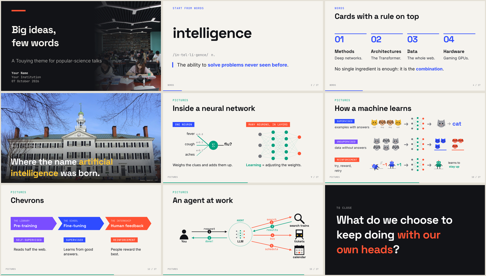

# divulga

A [Touying](https://touying-typ.github.io) theme for [Typst](https://typst.app), made for
**popular-science talks**: big type, few words, full-bleed photos, and diagrams drawn
natively in Typst (no images to maintain).



Design rules:

- **slides anchor the talk**, the talk carries the content: little text, set big;
- **one accent colour per part** of the talk, set by `part-slide` and carried by
  titles, highlights, bullets and the progress bar;
- **editorial look**: sharp corners, thick rules instead of boxes, mono labels;
- everything is a function, so diagrams follow the palette and the current accent.

## Quick start

```sh
git clone https://github.com/cric96/typst-theme-divulga
cd typst-theme-divulga
make pdf            # → example.pdf, built from template/main.typ
make watch          # live reload
make notes          # speaker notes for pdfpc
```

Start your own deck by copying `template/main.typ`:

```typ
#import "lib.typ": *            // path to this repo

#show: divulga-theme.with(lang: "en", config-info(title: [My talk]))

#title-slide(title: [Big ideas], subtitle: [few words], author: [Me], image: image("cover.jpg"))

#part-slide(number: "01", title: [Understanding], color: palette.blue)

#slide(title: [A definition])[
  #definition([intelligence], pron: [in·tel·li·gence], kind: [n.])[
    The ability to *solve problems never seen before*.
  ]
]
#speaker-note[What to say here.]
```

### Fonts

The theme uses **Space Grotesk** (titles), **Inter** (text) and **JetBrains Mono**
(labels), all under the SIL Open Font License. They are in `fonts/`: either pass
`--font-path fonts` to `typst` (the Makefile does it) or install them on your system.
In VS Code with Tinymist, add `"tinymist.fontPaths": ["${workspaceFolder}/fonts"]`.

### Images

Pass pictures as `image("photo.jpg")`: this works whether the theme is local or
imported as a package. The theme crops them to fill the space (`fit: "cover"`).
A plain path string also works, but only when the theme files live inside your project.

## Slides

| Function | What it does |
| --- | --- |
| `title-slide(title, subtitle, author, affiliation, date, image)` | dark cover, optional photo on the right |
| `part-slide(number, title, subtitle, color)` | opens a part: huge number, sets accent colour and footer label |
| `slide(title, kicker, align)[...]` | kicker + big title + body (vertically centred by default) |
| `statement-slide(kicker, dark, fill, size, attribution)[...]` | one sentence, set huge |
| `image-slide(img, kicker, caption, credit)` | full-bleed photo with caption |
| `split-slide(img, title, side, ratio, credit)[...]` | photo on one side, text on the other |

Touying features work as usual: `#pause`, `#speaker-note[...]`, and callback slides
(`#slide(repeat: 3, self => [...])` with `utils.methods(self)`) for `uncover`/`only`.

## Building blocks

| Function | What it does |
| --- | --- |
| `definition(term, pron, kind)[...]` | dictionary-style definition |
| `senses(..items)` | numbered list in accent colour |
| `card(title, tag, number)[...]` | thick rule on top, label or big number, text |
| `big-number(n, label, color, size)` | figure + caption |
| `quote-block(who, size)[...]` | pull quote |
| `pill(body, fill)` | solid mono label |
| `kicker(body)` · `hl(body)` · `source(body)` · `pic(img, width, height)` | small helpers |

`*strong*` text is coloured with the current accent. Colours live in `palette`
(`blue`, `green`, `coral`, `violet`, `sun`, `ink`, `paper`, `muted`, ...).

## Diagrams

| Function | What it draws |
| --- | --- |
| `timeline(events, height)` | events alternating above/below a line; `(year, label, color)` or `(year:, label:, color:, hollow: true)` |
| `attention(words, focus, weights)` | a sentence with attention arcs to one word |
| `perceptron(inputs, weights, output)` | one artificial neuron |
| `network(layers)` | a layered neural network, e.g. `(3, 5, 5, 2)` |
| `flow(steps, colors)` | steps on a coloured rule, joined by arrows |
| `chevrons(steps, colors)` | arrow-shaped steps with text inside and an optional caption below |
| `learning-flow(tag, caption, input, output)` | label · input → network → output, with `panel` and `scatter` |
| `agent-loop(think, act, observe, goal)` | the agent cycle |
| `agent-diagram(stage, user, llm, tools, labels)` | user ↔ LLM ↔ three tools, revealed step by step |

## Icons

Hand-drawn vector icons, all taking `size` and `fill`:
`cat`, `dog`, `robot` (with `angle`), `robot-fallen`, `robot-standing`, `person`,
`magnifier`, `train`, `calendar`.

## Credits

- Built on [Touying](https://github.com/touying-typ/touying).
- Example photos from Wikimedia Commons, CC0: Dartmouth Hall by Daderot; students
  studying by Gary Todd.
- Fonts: Space Grotesk (Florian Karsten), Inter (Rasmus Andersson), JetBrains Mono — SIL OFL 1.1.

## License

Apache-2.0 for the code. Fonts keep their own licenses (see `fonts/`).
